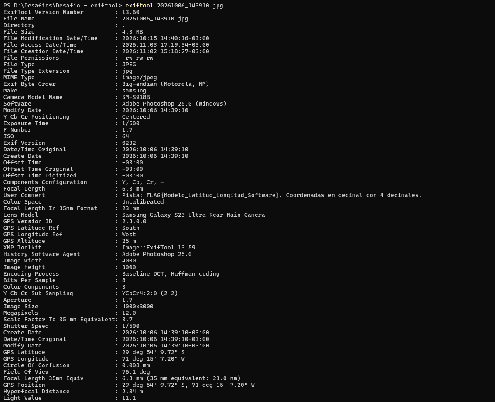

Desafio Exiftool

La aplicacion es sencilla de utilizar solamente, se debe poner la imagen en el powershell con el siguiente comando "exiftool 20261006_143910.jpg".
Y da todo lo necesario para ver los metadatos de la imagen que son los siguientes:

Aqui estan las respuestas de las preguntas de nuestro compañeros:

1. Si coincide el nombre de la foto con los metadatos. El nombre indica 2026-10-06 14:39:10 y la metadata EXIF muestra lo mismo:
  Date/Time Original              : 2026:10:06 14:39:10
  Create Date                     : 2026:10:06 14:39:10
  Offset Time Original            : -03:00
  La zona horaria es UTC-03:00 (hora de Chile).

2. La camara que se utilizo es la siguiente:
  Make                            : samsung
  Camera Model Name               : SM-S918B
  Lens Model                      : Samsung Galaxy S23 Ultra Rear Main Camera
  Exposure Time                   : 1/500
  F Number                        : 1.7
  ISO                             : 64
  Focal Length In 35mm Format     : 23 mm

3. Si salen coordenadas de donde fue sacada la imagen (no fue despojada de la ubicacion), son las siguientes:
  GPS Version ID                  : 2.3.0.0
  GPS Latitude                    : 29 deg 54' 9.72" S
  GPS Longitude                   : 71 deg 15' 7.20" W
  GPS Altitude                    : 25 m

  Convertidas a formato decimal (Sur y Oeste son negativos):
  Latitud  = -(29 + 54/60 + 9.72/3600) = -29.9027
  Longitud = -(71 + 15/60 + 7.20/3600) = -71.2520

  Coordenadas: -29.9027, -71.2520 (zona de La Serena, Chile)
  Comando para obtenerlas directo: exiftool -n -c "%.4f" -GPSLatitude -GPSLongitude 20261006_143910.jpg

4. Integridad y Mineria Oculta:
  - MakerNotes: NO existen. Un Samsung SM-S918B original siempre los guarda, por lo que fueron eliminados.
  - ThumbnailImage / PreviewImage: NO existen. No hay miniatura incrustada (falta el bloque IFD1).
  - Software de edicion: SI, la imagen paso por Adobe Photoshop:
      Software                        : Adobe Photoshop 25.0 (Windows)
      History Software Agent          : Adobe Photoshop 25.0
      XMP Toolkit                     : Image::ExifTool 13.59

  Conclusion: la imagen no es un original de la camara. Se perdieron los MakerNotes y la miniatura
  porque fue re-editada/re-comprimida, y los metadatos indican Adobe Photoshop 25.0 (Windows), tambien es una herramienta muy poderosa si se tiene la foto original de algo, se pueden extraer demasiadas cosas con esta herramienta.

  Eticamente se puede usar en mal uso esta herramienta, porque se pueden robar imagenes reales de una personas y saber todo sobre ella.

  Observacion extra: hay indicios de que la etiqueta de Photoshop fue escrita a mano con ExifTool,
  porque el XMP fue generado por "Image::ExifTool 13.59" (Photoshop usa "Adobe XMP Core"), el historial
  solo tiene el softwareAgent (sin action ni fecha) y faltan los segmentos que Photoshop agrega al
  exportar (APP13 Photoshop/8BIM, APP14 Adobe y perfil ICC). O sea, los metadatos fueron manipulados.

  Comandos usados:
    exiftool -a -G1 -s 20261006_143910.jpg
    exiftool -v2 20261006_143910.jpg | Select-String "JPEG APP|DQT|SOF"
    exiftool -xmp -b 20261006_143910.jpg

FLAG

La pista del campo User Comment dice: FLAG{Modelo_Latitud_Longitud_Software} con coordenadas en decimal con 4 decimales.

  FLAG{SM-S918B_-29.9027_-71.2520_Adobe Photoshop 25.0 (Windows)}
